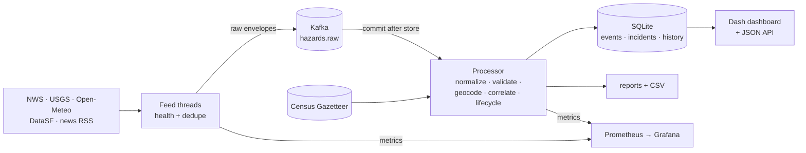

# SAURON

A multi-source geospatial event pipeline. It ingests public hazard data (National Weather Service alerts, USGS
earthquakes, Open-Meteo conditions, San Francisco police collision records, news headlines), normalizes it
into one validated schema, places it on the map only as precisely as the evidence allows, merges reports of the
same incident, tracks each incident from open to cleared, and serves the result through a dashboard and a
read-only API.

It turns scattered event feeds into a consistent, searchable, auditable incident record: for any incident you
can see which sources reported it, when, how its location was determined, and why it was cleared.

This is a personal engineering project. It has not been deployed for customers or run at scale.



## Try it

Offline demo with no network, broker or credentials. It replays real responses captured from the sources on
2026-10-15:

```sh
python -m venv .venv && . .venv/bin/activate
pip install -r requirements-dev.txt
python -m src --demo            # http://127.0.0.1:8050
```

Live, with Docker:

```sh
cp .env.example .env            # optional: contact email, dashboard password
docker compose up -d --build    # dashboard :8050, Prometheus :9090, Grafana :3000 (all on 127.0.0.1)
```

Live without Docker (no broker; not durable):

```sh
python -m tools.fetch_gazetteer
SAURON_TRANSPORT=local python -m src
```

Tests:

```sh
pytest                                              # 175 tests, offline
docker compose up -d kafka kafka-init
SAURON_KAFKA_TEST=1 pytest tests/integration        # against a real broker
```

## What it does

| Source | Becomes |
|---|---|
| NWS active alerts (one nationwide request) | Weather incidents with the alert's own polygon or its forecast-zone polygons; updates linked through CAP references; cleared when the source expires or withdraws them |
| USGS earthquakes ≥ M2.5 | Seismic events with magnitude, depth and metadata; never treated as road incidents |
| Open-Meteo at configured points | Model-estimated wind, fog, ice, snow, heavy rain and thunderstorm conditions, with unit-checked thresholds |
| DataSF traffic collisions | Historical, point-located collision records (published 1-3 days late) |
| Google News RSS | Unverified road-incident reports, located only from places named in the headline; corroborated when two outlets report the same crash |

Every incident shows its **verification** (official, model estimate, corroborated, unverified), **location
confidence** (source point/area, geocoded high/medium, low, unresolved), state, clear reason, evidence and
history.

Around that core:

- **Feed health.** Every poll ends as a success (zero items is normal) or a named failure (`timeout`, `connection`,
  `http_<code>`, `parse`, `publish`, `internal`); NWS uses ETag conditional requests and honours `Retry-After`.
- **Correlation.** Same event id, CAP references, USGS alternate ids, Open-Meteo series, then roadway reports in the
  same or neighbouring H3 cell within ±180 minutes, rejected when they name different roads or directions.
- **Replay.** Kafka holds what the sources said, so improved mappers can be replayed over old data; writes are
  idempotent through content-hash versioning.
- **Dashboard.** Incidents, map (markers, clusters, heatmap, warning polygons; no WebGL), source events, analytics
  and system health, with filters, light/dark themes, CSV export and per-incident reports.
- **API.** Incidents with filters, bounding box and keyset pagination; incident detail with evidence and history;
  NWS alerts covering a point during a time window; `/healthz` and `/readyz`.
- **Monitoring.** Prometheus metrics and alert rules, a provisioned Grafana dashboard, JSON logs.
- **Security.** Loopback by default; refuses a public address without a password or API token; constant-time
  credential checks; unprivileged container.

## What it does not do

- It is not a live traffic feed: news is usually published hours after an incident.
- It does not guess locations. A headline that names no place, or an ambiguous one, stays off the map.
- It does not claim damage. A warning covering a location is not evidence that the location was damaged, and no
  clear reason claims a hazard physically ended.
- It does not promise exactly-once delivery; it is at-least-once with idempotent writes.
- It collects no person-level data.
- It is not a multi-user product: no accounts, audit log or billing; TLS belongs in a reverse proxy.
- It is not licensed for commercial use as configured (Open-Meteo free tier, Google News headlines).
- The property and storm-intelligence report is [designed](docs/storm-intelligence-design.md), not built.

See also [Known limitations](#known-limitations).

## Engineering problems solved

- **Silent failure.** The original NWS parser decoded JSON twice and swallowed the error, so it never produced an
  alert (0 of 525 on a live response). Every feed now reports success, failure category and last success, and
  quiet sources are distinguished from broken ones.
- **Unit errors.** Wind gusts in km/h were compared with an m/s threshold and visibility in metres with a
  kilometre threshold: 1,343 of 1,509 historical weather "hazards" were ordinary breezes, and fog could never fire.
  Units are now requested explicitly and verified.
- **Replay duplication.** A pass-through Spark job with its checkpoint in `/tmp`, plus a consumer with no group,
  re-processed the whole topic on every restart (18,451 CSV rows for 4,753 hazards). Offsets are now committed
  only after storage, writes are idempotent, and a full replay is shown to change nothing.
- **Geographic ambiguity.** "Crash in Canton" could be in any of a dozen states. The resolver uses only places named
  in the text, lets the outlet's market choose between same-named places but never supply a location, and
  leaves ambiguous names unmapped.
- **Areas vs points.** County-wide warnings keep their polygons; "which warnings covered this point" is an exact
  point-in-polygon query, not a centroid comparison.
- **Lifecycle.** Expiry, withdrawal and "no longer observed" are separate clear reasons, and none of them claims the
  hazard physically ended.
- **Privacy.** SAURON keeps event-level data only. Person-level contact enrichment was removed, and follow-up
  headlines (which are the ones that name victims) are filtered out.

## Results

Measured on 2026-10-15; method, commands and caveats in [docs/data-quality.md](docs/data-quality.md).

**Headline geocoding, held-out set** (78 hand-labeled headlines, labeled after the code was frozen):

| | Original pipeline | Current |
|---|---|---|
| Wrong placements | 23 of 47 placed (49%) | 1 of 23 placed (4%) |
| Correct, of 58 headlines with a known place | 19 | 22 |
| Left unresolved, of 58 | 19 | 35 |

The improvement is in not placing incidents wrongly; coverage stays limited by what headlines actually say.

**News classification** (incident vs follow-up vs other), same holdout: precision 0.947, recall 1.0.

**Weather rules**: re-checking the 1,343 historical wind "hazards" against the corrected thresholds, 8 (0.6%)
qualify; none of the 136 historical "snow" hazards do.

**Replay**: processing the same log twice, or into a fresh store, gives identical results; against a real Kafka
broker, restart reprocessed 0 messages and a full replay changed nothing.

**Throughput** (processing only, this laptop): 785 messages/s first pass (p95 9.5 ms), 2,422/s replay.

**Live run** (Docker Compose, real sources, 11 minutes): all 17 polls succeeded, 178 events stored, 0 dead
letters; new NWS alerts were queryable a median 67 s after publication (n=6). Short window; details in
[docs/data-quality.md](docs/data-quality.md#live-run).

## Technologies

| Area | Technology |
|---|---|
| Language | Python 3.12 |
| Streaming | Apache Kafka 3.9.1 (KRaft, single node), kafka-python 2.2.15 |
| Storage | SQLite in WAL mode |
| Geospatial | H3 4.5.0, US Census Gazetteer 2025, point-in-polygon and Douglas-Peucker in `src/geo.py`, optional Nominatim |
| Ingestion | requests 2.32.4, feedparser 6.0.11, PyYAML 6.0.2 |
| Dashboard | Dash 3.1.1 (Flask), dash-bootstrap-components 2.0.3, Plotly 6.2.0, pandas 2.3.1 |
| Maps | Leaflet 1.9.4, Leaflet.markercluster 1.5.3, Leaflet.heat 0.2.0; USGS The National Map and OpenStreetMap tiles |
| Observability | prometheus_client 0.22.1, Prometheus 2.53.0, Grafana 11.1.0 |
| Packaging | Docker (python:3.12-slim, non-root), Docker Compose |
| Testing | pytest 9.1.1 |
| Project site | Static HTML, CSS and JavaScript, deployed on Vercel |

Apache Spark, Neo4j and Redis were part of the original design and were removed; the reasons are in
[docs/architecture.md](docs/architecture.md#decisions).

## Project site

`site/` is a static page describing the project, with an interactive map and table of the offline demo's real
output. `python -m tools.build_site` regenerates `site/data/demo.json` from the bundled fixtures, and a test fails if
the committed file is stale. Vercel serves `site/` as static files (`vercel.json`); the pipeline itself needs
long-running threads, a Kafka broker and a writable database, so it does not run there.

## Documentation

- [Architecture and design decisions](docs/architecture.md): why Spark, Neo4j and Redis were removed
- [Data model](docs/data-model.md): schema, location confidence, lifecycle, correlation
- [Sources](docs/sources.md): endpoints, licenses, parsing rules, removed sources
- [Operations](docs/operations.md): configuration, security model, monitoring, replay, legacy data
- [API](docs/api.md)
- [Data quality](docs/data-quality.md): baseline defects and measured results
- [Evaluation data](eval/README.md)
- [Next stage: property and storm intelligence (design)](docs/storm-intelligence-design.md)

## Known limitations

- Most news headlines cannot be located from their text; 35 of 58 located holdout headlines stay unresolved.
- County-level locations are county centroids; for large counties they can be 100+ km from the incident.
- NWS zone polygons are simplified to about 50 m.
- News is polled every 5 minutes and is usually published hours after an incident; it is a signal, not a live feed.
- Only data collected while running is searchable; there is no historical backfill.
- Single process, single broker partition, SQLite: sized for thousands of events a day, not millions.
- The outlet-market table covers 189 outlets (plus 9 marked non-US); others get no disambiguation.
- Open-Meteo's free tier and Google News headlines are not licensed for commercial use.
- Basemap tiles come from the USGS and OpenStreetMap servers; without internet access the map shows incidents and
  warning areas on a blank background and says so.

## Layout

```
src/            pipeline: ingestion/, schema, geocoding, incidents, processor, store, dashboard, api
tools/          demo, gazetteer download, evaluation, benchmark, legacy-data migration, site export
tests/          unit and integration tests, real source fixtures
eval/           labeled headlines and evaluation results
monitoring/     Prometheus config and alert rules, Grafana provisioning
config/         pipeline config, outlet markets
site/           static project site (Vercel) and its demo data
docs/
```

Data: NWS, USGS and US Census data are public domain. DataSF under its open data terms. Open-Meteo under CC BY 4.0.
Basemaps: U.S. Geological Survey The National Map (public domain) and © OpenStreetMap contributors.
