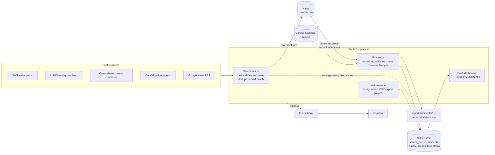

# Architecture

SAURON is one Python process (feeds, processor, maintenance loop, dashboard/API) plus a single-node Kafka broker.
Prometheus and Grafana are optional observers.

## Data flow

1. **Feeds** (`src/ingestion/`) poll each source on its own interval. A poll either succeeds (possibly with
   zero items, which is normal) or fails with a category: `timeout`, `connection`, `http_<code>`, `parse`,
   `publish`, `internal`. Success, failure, item counts and the last error are recorded in `feed_status` and
   exported as metrics. Failed polls back off exponentially.
2. Each new source item is wrapped in a **raw envelope** (`{"v": 2, "feed", "kind", "fetched_at", "item"}`) and
   published to `hazards.raw` with `acks=all`. The raw log holds what the source said, not SAURON's interpretation,
   so improved mappers can be replayed over old data.
3. The **processor** (`src/processor.py`) consumes the topic in the `sauron-processor` consumer group with
   auto-commit off. For each envelope it runs the source mapper (`src/hazard_enrichment.py`), validates the
   result against the canonical schema (`src/schema.py`), and stores it in one SQLite transaction together with
   the incident update (`src/incidents.py`). Offsets are committed only after the whole batch is stored.
4. **Incident reports** and the CSV export are generated from the store, never appended, so replays cannot
   duplicate them.
5. The **dashboard and API** (`src/dashboard.py`, `src/api.py`) read the store with bounded, indexed queries.

## Delivery guarantees

At-least-once delivery with idempotent writes; there is no claim of exactly-once.

- A crash after storing but before committing replays part of a batch. Replays are harmless: a source event is
  identified by `event_id`, and a version is only added when its content hash changes
  (unique index on `(event_id, content_hash)`).
- If SQLite fails (disk full, I/O error), the batch is rolled back, the consumer seeks back to the first offset
  of the batch, and processing retries after 5 seconds. Nothing is committed.
- A message that cannot be parsed, fails schema validation or crashes incident logic is written to
  `dead_letters` with its topic/partition/offset and processing continues, so one bad message cannot block the
  partition.
- Feeds keep an in-memory set of recently published item hashes. After a restart they republish once; the store
  absorbs the repeats. This was observed in a live restart (133 repeats suppressed, 5 genuinely new events stored).
- Incident IDs are derived from the first source event (`inc_` + SHA-256 prefix) and history timestamps come
  from source/observation times, so replaying the same log with the same reference clock produces an identical
  store (`tests/test_processor.py::test_full_replay_into_a_fresh_store_is_identical`).

## Decisions

### Spark was removed
`SparkManager` read `hazards.raw` and wrote `selectExpr("value")` to `hazards.enriched`: a byte-for-byte copy
that started a JVM. Its checkpoint lived in the container's `/tmp`, so every restart re-forwarded the whole raw
topic. Together with the old writer's `group_id=None` and `auto_offset_reset="earliest"`, this is why the legacy
CSV holds 18,451 rows for 4,753 hazards. Consuming `hazards.raw` directly is the same input with one fewer copy.
Spark would make sense again only for windowed aggregations over far more data than one process can hold.

### Neo4j was replaced by SQLite
Neo4j stored one `Hazard` node per event with no relationships. Every dashboard query was a full scan that
regex-parsed string timestamps. The workload is append-mostly, single-writer, a few hundred to a few thousand
events per day, and queried by time, category and bounding box. SQLite in WAL mode handles that with indexes, needs
no service, and is trivial to back up. Evidence and history are one-to-many tables. A multi-writer deployment, or
spatial queries over millions of polygons, would justify Postgres + PostGIS.

### Redis was removed
Redis provided feed deduplication and a geocoding cache, without persistence (no volume in the old compose
file). Deduplication now lives in the store (content-hash versioning) with an in-memory first line in each
feed. Geocoding is local (Census Gazetteer). The optional Nominatim cache and NWS zone geometries are in
SQLite and survive restarts.

### Kafka was kept
It is the durable raw log: sources are polled independently of processing, the processor can be stopped or
redeployed without losing polls, and history can be replayed through new mapper versions. One partition is
enough at current volume and keeps ordering simple (NWS snapshots follow the alerts they describe).

## Geometry

- NWS alerts come with a polygon (storm-based warnings) or only with forecast/county zone references (about 94%
  of active alerts when checked). Zone geometries are fetched once, simplified with Douglas-Peucker at 0.0005°
  (about 50 m), rounded to 5 decimals and cached; some Alaska zones are 5-8 MB of raw GeoJSON. An alert is held
  back until its zones are cached (at most 10 polls) so its stored geometry is complete. Zones may come back as
  GeometryCollections; they are flattened to MultiPolygons.
- Area events keep their polygons and get no point coordinates or centroid.
- "Which warnings covered this point" uses a bounding-box index to pick candidates, then exact ray-casting
  point-in-polygon with hole support (`src/geo.py`). Map display uses a coarser simplified copy.
- Point events get an H3 cell (resolution 7, about 5 km² per cell) for correlation candidates (`grid_disk` k=1).

## Process model

Feeds, processor and maintenance are daemon threads in the dashboard process. SQLite connections are
per-thread. The `local` transport (`SAURON_TRANSPORT=local`) swaps Kafka for an in-memory queue for development
without a broker; it is not durable and cannot be replayed.
